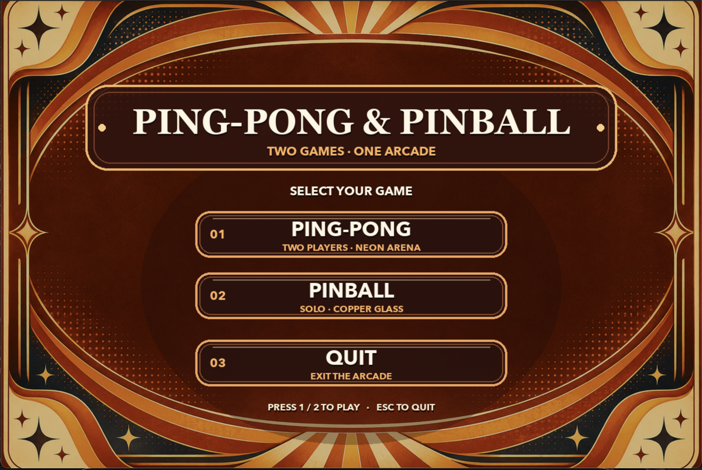
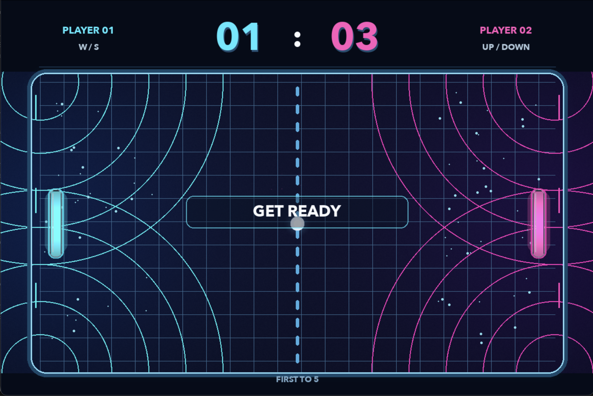
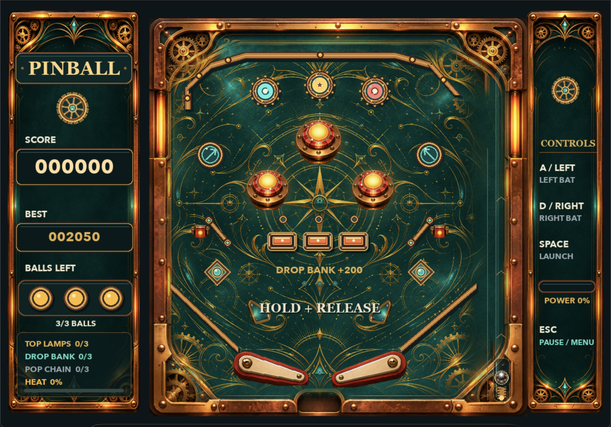

# Ping-Pong & Pinball

**Ping-Pong & Pinball** — учебное аркадное приложение на Python и Pygame с двумя игровыми режимами, общим стартовым меню, графикой, анимацией и звуковыми эффектами. Игры рассчитаны на локальный запуск без подключения к сети.

**Авторы:** Логинов Владислав Игоревич, Рябов Максим Алексеевич  
**Группа:** ПИ25-3  
**Дисциплина:** Практикум по программированию

## Игровые режимы

| Режим | Описание | Подробнее |
| --- | --- | --- |
| **Ping-Pong — Neon Showdown** | Игра для двух участников за одной клавиатурой: неоновая арена, управление ракетками, отскоки и счёт до пяти очков. | [README Ping-Pong](src/pong/README.md) |
| **Pinball — Copper Glass** | Одиночный пинбол с запуском шарика, флипперами, бамперами, мишенями, системой очков и бонусными режимами. | [README Pinball](src/pinball/README.md) |

Обе игры запускаются из одного приложения. В стартовом меню можно выбрать режим мышью или клавишами `1` и `2`. При переключении размер окна подстраивается под выбранную игру.







## Возможности

- **Единое приложение:** главное меню в оранжево-кремовой ретро-стилистике, запуск двух игр и возврат в меню без перезапуска программы.
- **Ping-Pong:** два игрока на одной клавиатуре, независимое управление ракетками, изменение угла отскока, ускорение мяча, счёт до 5, пауза и экран победителя.
- **Pinball:** физика шарика, управляемые флипперы, датчики и препятствия, пусковой механизм, очки, серия попаданий с множителем ×2, Perfect Flip и визуальный режим Overheat.
- **Оформление:** отдельные изображения и звуковые эффекты для главного меню, Pong и Pinball.
- **Управление состояниями:** пауза, возобновление, новая партия, возвращение в меню и завершение приложения.
- **Проверки:** автоматические тесты игровой логики и интеграции экранов.

## Требования

- **Python 3.9 или новее** с поддержкой используемой версии Pygame.
- **Pygame 2.6.1** — единственная обязательная сторонняя зависимость, указанная в `requirements.txt`.
- **macOS, Windows или Linux** с графическим окружением.
- Клавиатура; мышь используется для кнопок меню.

Интернет нужен только для получения проекта и установки зависимости. Изображения и звуки хранятся локально в `assets/`.

## Установка и запуск

Все команды выполняются **из корня репозитория**, в котором находятся `main.py` и `requirements.txt`.

### macOS

```bash
python3 -m venv .venv
source .venv/bin/activate
python -m pip install -r requirements.txt
python main.py
```

### Windows (PowerShell)

```powershell
py -m venv .venv
.\.venv\Scripts\Activate.ps1
python -m pip install -r requirements.txt
python main.py
```

Если PowerShell запрещает активацию, можно запустить Python из окружения напрямую: `.\.venv\Scripts\python.exe -m pip install -r requirements.txt`, а затем `.\.venv\Scripts\python.exe main.py`.

### Linux

```bash
python3 -m venv .venv
source .venv/bin/activate
python -m pip install -r requirements.txt
python main.py
```

В некоторых дистрибутивах сначала потребуется установить системный пакет для создания виртуальных окружений (`python3-venv`).

> Проект может уже содержать папку `venv/` из предыдущей разработки. Для новой установки удобнее использовать **`.venv/`**, чтобы не зависеть от путей и пакетов другой операционной системы. Виртуальное окружение не является частью исходного кода игры.

## Управление

| Экран | Действие | Управление |
| --- | --- | --- |
| Главное меню | Выбрать Pong / Pinball | Мышь или `1` / `2` |
| Главное меню | Выйти из приложения | `Esc` или `Quit` |
| Pong | Левая ракетка | `W` / `S` |
| Pong | Правая ракетка | `↑` / `↓` |
| Pong | Пауза / продолжение | `Esc` |
| Pong | Новая партия после победы | `R` или `Restart` |
| Pinball | Левый / правый флиппер | `A` / `D` или `←` / `→` |
| Pinball | Зарядить и запустить шарик | Удерживать и отпустить `Space` |
| Pinball | Пауза / продолжение | `Esc` |
| Любая игра | Вернуться в главное меню | `F1` или кнопка `Main Menu` / `Menu` |

В меню паузы доступны кнопки управления партией. `Quit Game` закрывает всё приложение, а `Main Menu` возвращает к выбору режима.

## Структура проекта

```text
PPP_lab3_PingPong_Pinball/
├── main.py                      # Точка входа
├── requirements.txt             # Сторонние зависимости
├── README.md                    # Общая документация
├── src/
│   ├── app.py                  # Общий игровой цикл и переключение режимов
│   ├── menu/                   # Стартовое меню
│   ├── games/
│   │   ├── pong.py             # Совместимый импорт PongGame
│   │   └── pinball.py          # Отдельный запуск Pinball
│   ├── pong/                   # Игровая логика, физика и отрисовка Pong
│   │   └── README.md
│   └── pinball/                # Игровая логика, механизмы и отрисовка Pinball
│       └── README.md
├── assets/
│   ├── menu/                   # Фон и кнопки главного меню
│   ├── pong/                   # Спрайты и звуки Pong
│   └── pinball/                # Спрайты и звуки Pinball
├── docs/                       # Предпросмотр оформления
└── tests/                      # Автоматические тесты
```

Основной цикл расположен в `src/app.py`: он получает события Pygame, обновляет активный экран и вызывает его отрисовку. Каждая игра отдельно отвечает за свои правила, столкновения и отображение.

## Тестирование и стиль кода

Из корня репозитория:

```bash
python -m unittest discover -s tests -v
python -m compileall -q src main.py tests
```

Дополнительные инструменты проверки стиля устанавливаются отдельно и **не требуются для запуска игры**:

```bash
python -m pip install pycodestyle pydocstyle
python -m pycodestyle src/ main.py
python -m pydocstyle src/ main.py
```

## Самостоятельный запуск Pinball

При необходимости Pinball можно открыть без общего меню:

```bash
python -m src.games.pinball
```

Pong использует общее приложение и выбирается через `python main.py`.

## Документация

- [Ping-Pong: механика, управление и устройство кода](src/pong/README.md)
- [Pinball: механика, управление и устройство кода](src/pinball/README.md)

## Примечания

- При отсутствии доступного звукового устройства предусмотрено продолжение игры без звука.
- Для корректной загрузки ресурсов запускайте программу из корня проекта.
- Если запуск завершается ошибкой `ModuleNotFoundError: No module named 'pygame'`, проверьте активацию виртуального окружения и установку зависимостей.
