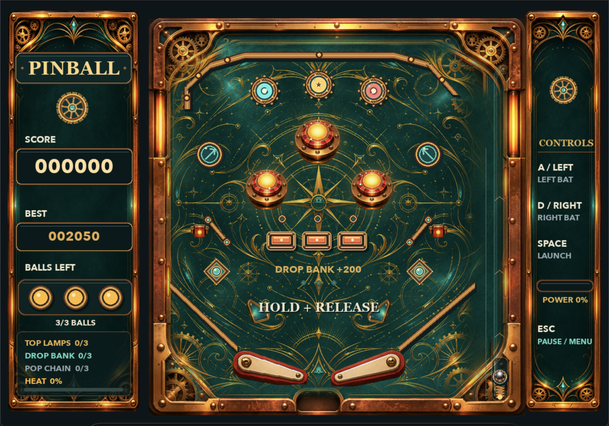

# Pinball — аркадный игровой автомат на Pygame

**Pinball** — самостоятельный игровой режим командного учебного проекта **Ping-Pong & Pinball**, написанный на Python с использованием Pygame. Игрок запускает металлический шарик, управляет двумя флипперами, отбивает его от препятствий и набирает очки. Визуальное оформление сочетает бирюзовое игровое поле, медные механизмы, гравировку и подсветку в духе ретро-аркад.

> Этот README относится **только к Pinball**. Общая точка входа и игра Ping-Pong находятся в других модулях репозитория.



*Макет оформления, собранный из игровых PNG. В реальной игре объекты анимированы, а счёт и подсказки обновляются в Pygame.*

## Возможности

- **Физика шарика:** гравитация, отскоки от стенок, металлических направляющих и препятствий; короткие физические подшаги для устойчивых столкновений.
- **Два управляемых флиппера:** анимация подъёма, отражение шарика и усиленный удар при своевременном нажатии.
- **Пусковой механизм:** удержание `Space` накапливает заряд, отпускание запускает шарик через отдельный правый канал.
- **Игровые объекты:** большие бамперы, боковые отбойники, треугольные slingshot-пластины, верхние индикаторы и направляющие ускорители.
- **Сбиваемые мишени:** три центральные мишени опускаются после попадания и возвращаются при следующем шарике.
- **Очки и бонусы:** обычные попадания, бонус за три верхние мишени, серия попаданий по бамперам с временным множителем ×2 и `Perfect Flip` за точный удар флиппером.
- **Overheat:** ограниченный по времени режим усиленных визуальных и звуковых эффектов после серии попаданий.
- **Три шарика на партию**, счёт и рекорд за текущий запуск программы, экран окончания игры и меню паузы.
- **Звук и анимация:** механические щелчки, удары, музыка Game Over, динамические блики и световые реакции. При недоступном аудиоустройстве игра продолжает работать без звука.

## Требования

- Python **3.9 или новее** (рекомендуется актуальная стабильная версия Python).
- [Pygame](https://www.pygame.org/) **2.6.1** — версия зафиксирована в корневом `requirements.txt`.
- Клавиатура и графическое окружение для запуска окна Pygame.
- Windows, macOS или Linux.

Дополнительных библиотек для игры не требуется. Изображения и звуки уже включены в репозиторий: `assets/pinball/`.

## Установка и запуск

Все команды выполняются **из корневой папки репозитория**, где лежит `requirements.txt`.

### macOS

```bash
python3 -m venv venv
source venv/bin/activate
python -m pip install -r requirements.txt
python -m src.games.pinball
```

На macOS команда `python` обычно доступна после активации `venv`; без активации может потребоваться `python3`.

### Windows — PowerShell

```powershell
py -m venv venv
.\venv\Scripts\Activate.ps1
python -m pip install -r requirements.txt
python -m src.games.pinball
```

Если PowerShell запрещает выполнение скриптов активации, можно запустить Python окружения напрямую без изменения настроек безопасности:

```powershell
.\venv\Scripts\python.exe -m pip install -r requirements.txt
.\venv\Scripts\python.exe -m src.games.pinball
```

### Linux

```bash
python3 -m venv venv
source venv/bin/activate
python -m pip install -r requirements.txt
python -m src.games.pinball
```

На некоторых дистрибутивах Linux может потребоваться сначала установить пакет `python3-venv` через системный пакетный менеджер.

## Управление

| Действие | Клавиши / управление |
| --- | --- |
| Левый флиппер | `A` или `←` |
| Правый флиппер | `D` или `→` |
| Зарядить и запустить шарик | Удерживать `Space`, затем отпустить |
| Открыть / закрыть меню паузы | `Esc` |
| Продолжить партию | `Resume Game` в меню или повторно `Esc` |
| Начать новую партию | `Restart` в меню или на экране Game Over |
| Завершить игру | `Quit Game` в меню или на экране Game Over |

Управление флипперами использует физическое положение клавиш: в русской раскладке `Ф` и `В` соответствуют `A` и `D`. Кнопка `Menu` в интерфейсе пока отключена — она предназначена для будущего общего меню двух игр. Клавиши `R` и `P` не используются для перезапуска и паузы.

## Игровой процесс

В начале партии доступно три шарика. Зажми `Space` для набора силы запуска, отпусти клавишу и отбивай шарик флипперами, не давая ему попасть в центральный или боковой слив. Попадания по игровым элементам добавляют очки и вызывают световые и звуковые эффекты.

**Pop Combo:** три последовательных попадания по большим бамперам за ограниченное время активируют множитель ×2 на 9 секунд. **Perfect Flip** даёт дополнительную награду за удар ближе к концу поднимающейся ракетки. **Overheat** усиливает свет и звук после серии попаданий, но не меняет физику шарика. Когда заканчиваются все шарики, появляется экран итогового результата и кнопки управления.

Рекорд `BEST` сохраняется **только до закрытия программы**: долговременное хранение результатов в файл пока не реализовано.

## Устройство проекта

```text
src/
├── games/
│   └── pinball.py          # Точка входа: python -m src.games.pinball
└── pinball/
    ├── README.md           # Эта документация
    ├── config.py           # Размеры, константы физики и цвета
    ├── collisions.py       # Геометрия и расчёт отражений
    ├── objects.py          # Шарик, флипперы, бамперы и направляющие
    ├── mechanisms.py       # Slingshot, DropTarget и LaneSensor
    ├── game.py             # Игровая логика, управление, счёт, жизни
    ├── renderer.py         # Отрисовка поля и интерфейса
    ├── sprites.py          # Загрузка PNG и масштабирование спрайтов
    ├── effects.py          # Визуальные эффекты попаданий
    └── sound.py            # Воспроизведение WAV

assets/pinball/           # Спрайты, фон и звуки sfx/*.wav
docs/pinball_preview.jpg  # Иллюстрация игрового режима
tests/                    # Автоматические проверки
```

`PinballGame` предоставляет методы `handle_event(event)`, `update(dt)` и `draw(surface)`. Они позволяют использовать игру как отдельный режим в общем приложении без переноса физики или отрисовки в `app.py`.

## Проверки

Для запуска тестов из корня репозитория:

```bash
python -m unittest discover -s tests -v
```

Проверка синтаксиса исходников:

```bash
python -m py_compile src/pinball/*.py src/games/pinball.py
```

Если установлены необязательные инструменты проверки стиля, можно дополнительно выполнить:

```bash
python -m pycodestyle src/pinball/ src/games/pinball.py
python -m pydocstyle src/pinball/ src/games/pinball.py
```

## Решение частых проблем

- **`python: command not found`** — активируйте виртуальное окружение или используйте `python3` (macOS/Linux), `py` (Windows).
- **`No module named pygame`** — установите зависимости через `python -m pip install -r requirements.txt` в активном окружении.
- **Не найдены изображения или звуки** — запускайте проект из корня репозитория и убедитесь, что папка `assets/pinball/` присутствует.
- **Нет звука** — проверьте громкость и аудиоустройство. Отсутствие звука не должно мешать игре.

## Об авторстве

Pinball разработан как отдельная часть совместной лабораторной работы по созданию аркадных игр на Python. В репозитории также находится независимый режим Ping-Pong и общий код приложения.
