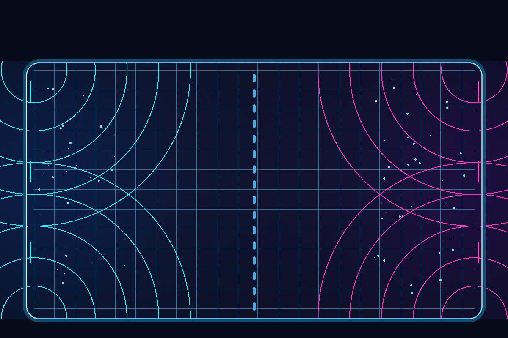

# Ping-Pong — Neon Showdown

**Ping-Pong** — соревновательный режим для двух игроков в общем проекте **Ping-Pong & Pinball**. Оба участника используют одну клавиатуру: каждый управляет своей ракеткой и старается отправить мяч за противоположную границу поля. Побеждает тот, кто первым наберёт **5 очков**.

Игра написана на **Python и Pygame**, а её логика, физика, графика и звуки разделены по модулям.

> Это документация только для Pong. [Общий README проекта](../../README.md) · [README Pinball](../pinball/README.md).


*Иллюстрация игрового поля, составленная из графических ресурсов проекта.*

## Игровой процесс

- **Два независимых игрока:** левая ракетка управляется клавишами `W/S`, правая — стрелками `↑/↓`. Одновременные нажатия обрабатываются независимо.
- **Отражение мяча:** угол вылета зависит от точки соприкосновения с ракеткой. Удар ближе к её краю изменяет траекторию сильнее, чем удар по центру.
- **Рост сложности:** после отбиваний скорость мяча постепенно увеличивается, но ограничивается максимальным значением.
- **Подсчёт очков:** очко получает игрок, чей соперник пропустил мяч. После каждого очка мяч возвращается в центр, затем начинается новая подача.
- **Победа:** партия заканчивается при достижении 5 очков одним из участников; появляется экран победителя.
- **Пауза:** клавиша `Esc` останавливает обновление матча и показывает кнопки возобновления, рестарта, возврата в главное меню и выхода.
- **Возврат в приложение:** пункт `Main Menu` и клавиша `F1` переводят в общее меню, где можно выбрать Pong или Pinball.

## Оформление

Визуальный стиль игры — **неоновая аркада**: тёмное игровое поле, подсветка голубой и розовой ракеток, светящийся мяч, след движения, вспышки и частицы при столкновениях.



*Фоновый спрайт арены. Ракетки, мяч, счёт, анимации и меню рисуются поверх него во время игры.*

Изображения находятся в `assets/pong/`, звуки — в `assets/pong/sfx/`. Используются короткие WAV-эффекты для отскоков от стен и ракеток, изменения счёта, действий меню и победы. Для звуков необязательна отдельная установка библиотек помимо Pygame.

## Управление

| Клавиша или кнопка | Действие |
| --- | --- |
| `W` | Поднять левую ракетку (игрок 1) |
| `S` | Опустить левую ракетку (игрок 1) |
| `↑` | Поднять правую ракетку (игрок 2) |
| `↓` | Опустить правую ракетку (игрок 2) |
| `Esc` | Открыть или закрыть паузу во время партии |
| `F1` | Вернуться в общее главное меню |
| `R` | Начать новую партию после победы |
| `Resume` | Продолжить игру после паузы |
| `Restart` | Сбросить счёт и начать новую партию |
| `Main Menu` | Вернуться к выбору игр |
| `Quit Game` | Закрыть приложение |

Кнопки на экране паузы и завершения партии нажимаются мышью. Во время паузы движение мяча и ракеток остановлено.

## Установка и запуск

Требуются **Python 3.9+** и **Pygame 2.6.1**. Все команды выполняются из **корня репозитория**, а не из `src/pong/`.

### macOS

```bash
python3 -m venv .venv
source .venv/bin/activate
python -m pip install -r requirements.txt
python main.py
```

### Windows (PowerShell)

```powershell
py -m venv .venv
.\.venv\Scripts\Activate.ps1
python -m pip install -r requirements.txt
python main.py
```

Если активация заблокирована, запускайте `.\.venv\Scripts\python.exe main.py` после установки зависимостей через тот же интерпретатор.

### Linux

```bash
python3 -m venv .venv
source .venv/bin/activate
python -m pip install -r requirements.txt
python main.py
```

После запуска выберите **Ping-Pong** мышью или нажмите `1` в главном меню. Встроенный режим Pong не имеет отдельной команды запуска через `python -m src.games.pong`: файл `src/games/pong.py` выполняет роль совместимого импорта.

## Организация кода

```text
src/
├── app.py                      # Переключение экранов приложения
├── games/
│   └── pong.py                # Совместимый импорт PongGame, Ball и Paddle
└── pong/
    ├── __init__.py
    ├── config.py              # Константы, размеры и цвета
    ├── entities.py            # Ракетки и мяч
    ├── physics.py             # Расчёт отскока
    ├── game.py                # Управление, очки, правила и события
    ├── renderer.py            # Арена, HUD, эффекты и экран паузы
    ├── sprites.py             # Загрузка графических ресурсов
    ├── audio.py               # Звуковые эффекты
    └── README.md              # Эта документация

assets/pong/
├── court.png
├── paddle_cyan.png
├── paddle_pink.png
├── ball.png
├── star_cyan.png
├── star_pink.png
└── sfx/
    ├── paddle.wav
    ├── wall.wav
    ├── score.wav
    ├── select.wav
    ├── pause.wav
    └── win.wav
```

### Как проходит игровой кадр

1. `src/app.py` получает события Pygame и передаёт их активной игре.
2. `PongGame` считывает независимо `W/S` и `↑/↓`, перемещает обе ракетки и обновляет мяч с учётом времени кадра (`dt`).
3. Система столкновений определяет отражение от стены или ракетки; функция из `physics.py` помогает вычислить угол отскока.
4. При выходе мяча за боковую границу начисляется очко, а затем подготавливается следующая подача.
5. `renderer.py` выводит фон, ракетки, мяч, счёт и эффекты. При паузе или победе поверх поля рисуется меню.

`PongGame` сообщает приложению о возвращении в главное меню через `menu_requested`, а о закрытии — через `quit_requested`. Благодаря этому Pong не управляет жизненным циклом всего приложения напрямую.

## Тестирование

Автоматические тесты запускаются из корня репозитория:

```bash
python -m unittest discover -s tests -v
python -m compileall -q src main.py tests
```

При желании проверьте форматирование и docstring:

```bash
python -m pip install pycodestyle pydocstyle
python -m pycodestyle src/pong/ src/games/pong.py
python -m pydocstyle src/pong/ src/games/pong.py
```

Тесты Pong и интеграции находятся в `tests/test_pong_physics.py` и `tests/test_arcade_integration.py`. Для части графических тестов необходим установленный Pygame; в автоматизированной среде используется тестовый видеодрайвер SDL.

## Связанные файлы

- [Главный README](../../README.md)
- [Стартовый экран приложения](../menu/menu.py)
- [Точка входа](../../main.py)
- [README Pinball](../pinball/README.md)
